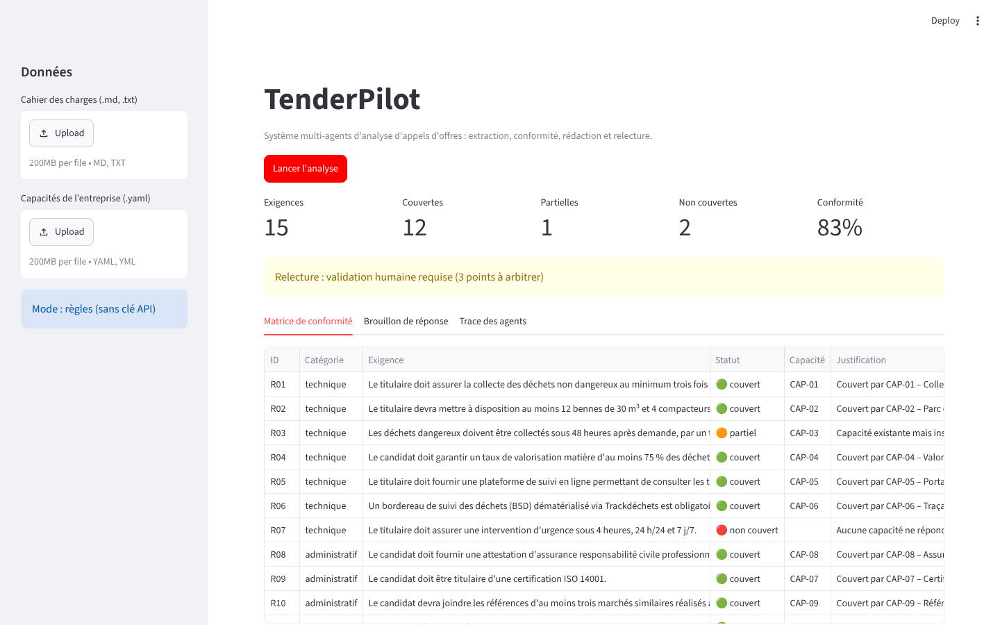
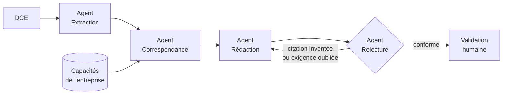

# TenderPilot – Agents IA pour répondre aux appels d'offres


Répondre à un appel d'offres demande de lire un dossier de consultation (DCE) long, d'en extraire chaque exigence, de vérifier ce que l'entreprise sait réellement faire, puis de rédiger un mémoire technique sans rien promettre de faux.

**TenderPilot** automatise ce travail avec **quatre agents IA orchestrés par LangGraph**. Chaque étape est **tracée, mesurée et vérifiée** par un agent relecteur avant qu'un humain ne valide la réponse.



## Ce que fait le système

| Agent | Rôle | Garde-fou |
|---|---|---|
| **Extraction** | Repère chaque exigence du DCE et la classe (technique, administratif, financier, RSE, délai) | Une simple information (ex. date de remise) n'est pas comptée comme une exigence |
| **Correspondance** | Confronte chaque exigence à la base des capacités de l'entreprise et **compare les contraintes chiffrées** (« sous 48 h » contre « sous 72 h », « au moins 75 % » contre « 82 % ») | Statut couvert, partiel ou non couvert, toujours justifié |
| **Rédaction** | Produit un brouillon de mémoire technique, **chaque affirmation citant sa source** `[CAP-xx]` | Aucune capacité inventée |
| **Relecture** | Vérifie les citations, repère les exigences oubliées, calcule un score de conformité et décide : *prêt à soumettre* ou *validation humaine requise* | Renvoie le brouillon à l'agent de rédaction en cas de défaut |



## Points forts techniques

- **Orchestration multi-agents avec LangGraph** : graphe d'états typé, boucle de correction relecture → rédaction, limitée à deux tentatives.
- **Observabilité** : chaque agent enregistre sa durée, son mode (règles ou LLM) et un résumé de son résultat. La trace complète est exportée en JSON.
- **Serveur MCP** : l'analyse est exposée comme outils (`compliance_matrix`, `draft_response`) utilisables directement depuis Claude Desktop, Cursor ou tout client MCP.
- **LLM au choix** (OpenAI ou Anthropic), avec **repli automatique** sur des règles déterministes si le LLM échoue ou renvoie un JSON invalide : le pipeline ne casse jamais.
- **Évaluation automatique** sur un DCE annoté à la main : précision et rappel de l'extraction, exactitude des statuts de conformité. Elle est lancée à chaque push dans la CI.
- **Tests** (pytest), dont un test qui simule un LLM qui invente une capacité, pour vérifier que le relecteur le détecte et fait réécrire le brouillon.

## Démarrage rapide

```bash
python -m venv .venv && source .venv/bin/activate   # Windows : .venv\Scripts\activate
pip install -e ".[dev,ui]"

# 1. En ligne de commande
python -m tenderpilot.cli data/dce_gestion_dechets.md

# 2. Interface web
streamlit run src/tenderpilot/app.py

# 3. Serveur MCP (pour Claude Desktop, Cursor…)
python -m tenderpilot.mcp_server
```

Sans clé API, tout fonctionne en mode « règles ». Pour utiliser un LLM, copiez `.env.example` en `.env`, ou définissez `LLM_PROVIDER=openai` / `anthropic` et la clé correspondante.

Exemple de sortie en ligne de commande :

```
[Extraction    ]     0.6 ms  (règles)  15 exigences extraites
[Correspondance]     6.5 ms  (règles)  12 couvert, 1 partiel, 2 non couvert
[Rédaction     ]     0.1 ms  (règles)  brouillon v1 (559 mots)
[Relecture     ]     0.8 ms  (règles)  score 83% – validation humaine requise – 3 points

Conformité : 83% – validation humaine requise
  - R03  exigence_partielle : Capacité existante mais insuffisante (exigé : 48 heures, proposé : 72 heures).
  - R07  exigence_non_couverte : Aucune capacité ne répond à cette exigence.
  - R15  exigence_non_couverte : Aucune capacité ne répond à cette exigence.
```

Le brouillon généré est visible dans [`docs/exemple_memoire_technique.md`](docs/exemple_memoire_technique.md) et la trace dans [`docs/exemple_trace.json`](docs/exemple_trace.json).

## Utiliser TenderPilot depuis Claude Desktop (MCP)

Ajoutez le serveur dans la configuration MCP de votre client (exemple : [`docs/claude_desktop_config.json`](docs/claude_desktop_config.json)), puis demandez simplement :

> « Voici un cahier des charges : donne-moi la matrice de conformité et les exigences que nous ne couvrons pas. »

L'assistant appelle l'outil `compliance_matrix` et répond à partir de résultats vérifiés.

## Évaluation

```bash
python eval/evaluate.py
```

| Métrique (mode règles, DCE d'exemple annoté) | Résultat |
|---|---|
| Extraction – précision / rappel | 100 % / 100 % (15 exigences) |
| Exactitude des statuts de conformité | 100 % (15/15) |

Ces résultats portent sur **un seul dossier d'exemple**, qui a aussi servi à mettre au point les règles. Ils montrent que le pipeline fonctionne de bout en bout, pas qu'il généralise. Sur des DCE réels, plus longs et moins réguliers, le mode LLM est indispensable pour l'extraction. La prochaine étape est d'annoter plusieurs DCE pour comparer objectivement le mode règles et le mode LLM.

## Structure

```
src/tenderpilot/
  agents/        extraction, correspondance, rédaction, relecture
  graph.py       orchestration LangGraph + trace
  text.py        mots-clés et comparaison des contraintes chiffrées
  llm.py         client OpenAI / Anthropic avec sortie JSON
  mcp_server.py  serveur MCP
  cli.py         ligne de commande
  app.py         interface Streamlit
data/            DCE et base de capacités d'exemple (entreprise fictive)
eval/            jeu annoté et script d'évaluation
tests/           tests unitaires et de bout en bout
```

## Pistes d'amélioration

- Lecture des DCE au format PDF (règlement de consultation, CCTP) avec découpage par article
- Recherche sémantique (embeddings) dans une base de références et de mémoires passés
- Export du mémoire en Word, au gabarit de l'entreprise
- Annotation de plusieurs DCE et suivi des métriques dans le temps

## Auteure

**Oumaima Mrhir** – Étudiante en Master 2 Informatique Décisionnelle (IDEAL), Université de Lorraine
[GitHub](https://github.com/OumaimaMrhir)

Licence MIT. Les données d'exemple (site de Valmont, entreprise Recyclia Services) sont fictives.
